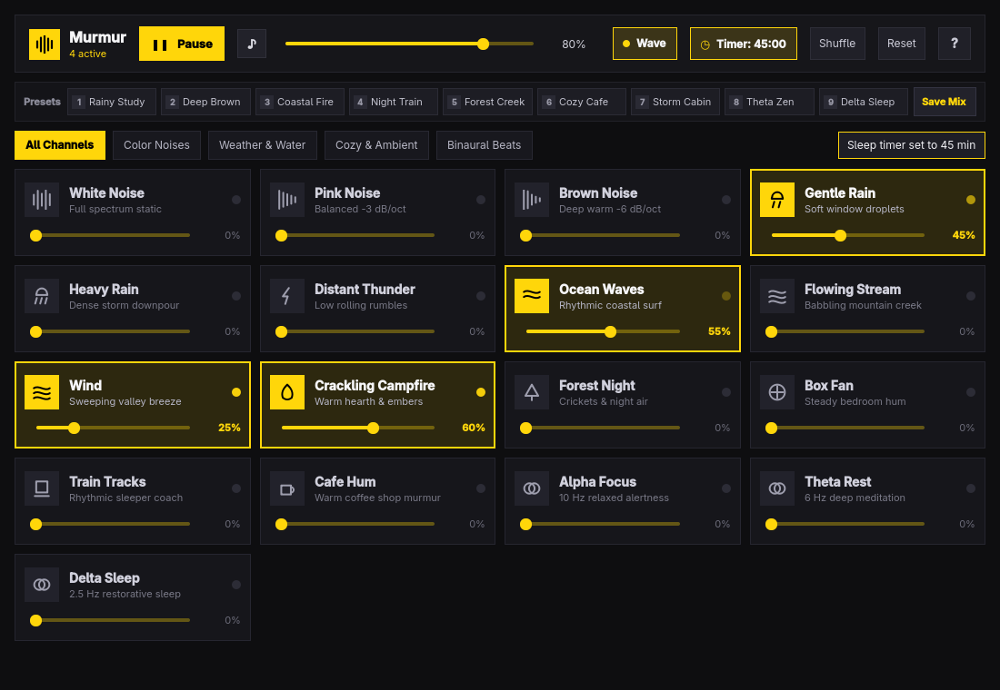

# Murmur

Ambient soundscape and white noise mixer for Omarchy. Synthesizes 17 stereo channels in real time — color noises, rain & weather, cozy environments, and binaural focus tones — with organic wave modulation, sleep fade-out timer, and instant keyboard presets.



## Keyboard Shortcuts

| Key | Action |
| :--- | :--- |
| `Space` | Play / Pause active soundscape |
| `1` – `9` | Load preset mix 1 through 9 |
| `Shift+1` – `9` | Save current mix into preset slot |
| `S` | Save current mix to preset |
| `W` | Toggle organic wave modulation |
| `T` | Cycle sleep timer (`Off`, `15m`, `30m`, `45m`, `60m`, `90m`, `120m`) |
| `M` | Mute / unmute master audio |
| `Up` / `Down` | Adjust master volume |
| `C` | Shuffle random ambient mix |
| `R` / `0` | Reset and clear all channels |
| `?` | Show or hide keyboard shortcuts |
| `Q` | Quit Murmur |

## Development

```sh
./bin/build
./bin/test
./bin/install
```
